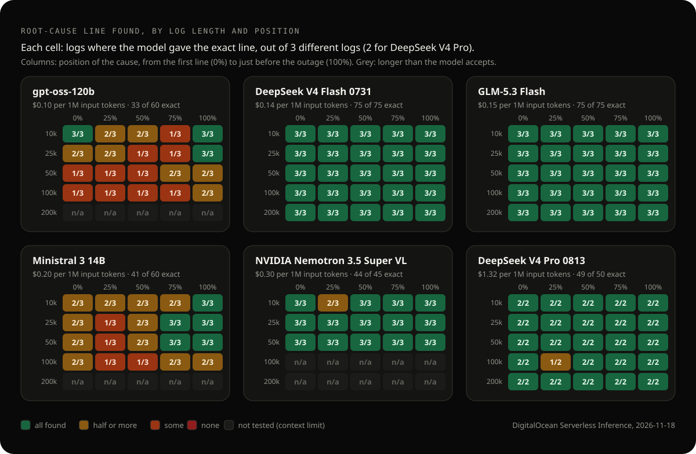

# incident-log-needle

Paste the whole incident log into a model and ask for the line that caused the outage. Where does it stop finding it?

This repo builds realistic incident logs from 10k to 200k tokens with one planted root cause, sends them to six models on [DigitalOcean Serverless Inference](https://docs.digitalocean.com/products/inference/), and scores the answers. It also tests the cheaper alternative: filter or chunk the log first, then ask a cheap model.

The write-up with the results is on DevOps Daily: https://devops-daily.com/posts/incident-log-root-cause-long-context-digitalocean-inference

```bash
git clone https://github.com/The-DevOps-Daily/incident-log-needle
cd incident-log-needle
cp .env.example .env                       # add your model access key
node scripts/01-build-haystacks.mjs        # 75 logs in data/haystacks/ (not in git) + data/truth.jsonl
node scripts/02-check-haystacks.mjs        # prove each log says what the truth file says
node scripts/02b-break-checker.mjs         # prove the checker can fail
mv results/raw ../raw-ours                 # keep our run outside results/ (the spend cap counts every call under results/)
node scripts/03-run-models.mjs --models deepseek-v4-flash-0731   # about $0.85 for one model
node scripts/04-score.mjs                  # results/summary.md and summary.json
node scripts/04b-stats.mjs                 # results/stats.md: the tests behind the claims
node scripts/05-two-step.mjs --models deepseek-v4-flash-0731   # grep and chunk baselines
node scripts/05b-score-two-step.mjs        # results/two-step-summary.md
node scripts/06-grid-svg.mjs               # results/grid.svg
```

Node.js 22 or later. No dependencies. The runner's spend cap (`SPEND_CAP_USD`, $14 by default) counts every call recorded under `results/`, including our pilots and baselines (about $2.40), so raise it or move those folders out if you run more.

## Results (18 November 2026)

367 recorded calls: 365 in the grid plus 2 GLM-5.3 Flash calls that failed four attempts with HTTP 529 and were run again. Exact root-cause line, by length (DeepSeek V4 tokens):

| Model | 10k | 25k | 50k | 100k | 200k | All (95% CI) |
| --- | --- | --- | --- | --- | --- | --- |
| DeepSeek V4 Flash (`deepseek-v4-flash-0731`) | 15/15 | 15/15 | 15/15 | 15/15 | 15/15 | 75/75 (95 to 100%) |
| GLM-5.3 Flash | 15/15 | 15/15 | 15/15 | 15/15 | 15/15 | 75/75 (95 to 100%) |
| DeepSeek V4 Pro (`deepseek-v4-pro-0813`, 2 logs per cell) | 10/10 | 10/10 | 10/10 | 9/10 | 10/10 | 49/50 (90 to 100%) |
| Nemotron 3.5 Super VL | 14/15 | 15/15 | 15/15 | too long | too long | 44/45 (88 to 100%) |
| Ministral 3 14B | 11/15 | 11/15 | 11/15 | 8/15 | too long | 41/60 (56 to 79%) |
| gpt-oss-120b | 11/15 | 9/15 | 7/15 | 6/15 | too long | 33/60 (42 to 67%) |



- The plan's claim failed for the strong models: no measurable drop with length up to 200k.
- The weak models already missed 4 of 15 at 10k. gpt-oss-120b blamed a line from the outage itself in all 27 of its misses (20 times the very first line of the outage). Ministral 3 14B blamed a harmless search-api deploy 7 times.
- Shape mattered most: the paused queue consumer (an info line) was found 0 of 12 times by gpt-oss-120b and 2 of 12 by Ministral 3 14B.
- A 200k-token paste cost $0.029 on DeepSeek V4 Flash and $0.276 on DeepSeek V4 Pro.

Details: `results/summary.md` (every cell, every miss, cost and latency), `results/stats.md` (the tests), `results/two-step-summary.md` (the grep and chunk baselines).

Eight calls on four logs were served from the prompt cache because pilot 2 had sent the same logs an hour earlier. They are priced as first pastes and left out of the latency numbers; their verdicts match the pilot's.

### Two-step baselines

On the 30 logs at 100k and 200k (`scripts/05-two-step.mjs`, `results/two-step-summary.md`):

- **grep-errors** kept the cause only in the cert shape: 3 of 15 at each length for both models.
- **grep-changes** (a best case: the change words were picked knowing the causes) lifted gpt-oss-120b from 6/15 to 13/15 at 100k (sign test p = 0.016) and cost DeepSeek V4 Flash about 7 times less than the whole 200k log.
- **chunks** (20k-token parts, up to 3 candidates each, then one final call) lifted gpt-oss-120b to 11/15 at 100k (p = 0.063). DeepSeek V4 Flash got 14/15 at both lengths, at 1.6 times the cost and 43 to 69 seconds per query. 5 of the 6 causes lost in the map step were the paused queue consumer.
- gpt-oss-120b hit a `tokens_per_day` limit during the 200k chunk runs (`results/rate-limit-2026-11-18.txt`): 3 of 15 done, all right, not in the post.
- The baseline gave DeepSeek V4 Flash 8,192 output tokens (the main run 16,384). With the cause filtered out, 9 of its 30 grep-errors calls used the whole budget without an answer.
- The chunk runs for DeepSeek V4 Flash and the last gpt-oss-120b attempts ran from a second machine after ours restarted; same code, same stamp.

## The claim, and what would prove it wrong

The plan, written before any call: accuracy falls as the log grows and as the cause moves away from the symptoms, so past some length a two-step approach (filter or chunk first, then ask a cheap model) beats pasting the whole log.

It is wrong if the models do as well at 200k as at 10k, or if the two-step approaches do worse than pasting everything.

## What a haystack is

A combined log from a small shop on Kubernetes: ingress (nginx), four APIs, a worker, Postgres, PgBouncer, Redis, RabbitMQ, Kubernetes events and audit lines, cert-manager and a config agent. One event per line, with an ISO timestamp and the source, numbered like `cat -n`.

Each log has, in time order:

- **Background**: requests, jobs, checkpoints, autovacuum, Redis saves, Kubernetes events for batch jobs, controller reads.
- **Harmless noise** (about 2.5% of lines): a retry that succeeds two lines later, deprecation warnings, a job that fails and passes on retry, a Redis reconnect, a client connection reset, a slow query, a `FailedScheduling` that is scheduled a few lines later, a 500 on a malformed search query.
- **Harmless changes**: changes of the same kind as the root cause but to something else (another PgBouncer pool, another certificate, another HPA, another Redis setting, another queue), plus deploys of an unrelated service.
- **The root cause** (the needle): one line, at a set depth of the part before the outage.
- **The outage**: from a fixed start time, symptoms (errors, 5xx responses, an alert) mixed with normal traffic.
- **The decoy**: one loud line a few seconds after the outage started that looks like a cause but is a consequence (an OOM kill, a crash loop, a circuit breaker opening, a process exit, a RabbitMQ memory alarm).

Five incident shapes rotate through the grid, so every length and every depth sees each shape three times:

| Shape | Root cause line | Level | What the symptoms say |
| --- | --- | --- | --- |
| pool | PgBouncer reload: `pool "orders" default_pool_size changed 50 -> 6` (values vary) | LOG | `db acquire timeout pool=orders`, 504s |
| cert | cert-manager: renewal of `payments-gateway-tls` failed, expiry time given | error | `x509: certificate has expired`, 502s |
| hpa | audit: `patch horizontalpodautoscalers checkout-api maxReplicas 24 -> 2` | none | `ScalingLimited`, `request queue full`, 503s |
| redis | config agent: `redis-cache maxmemory 4gb -> 64mb, noeviction` | info | `OOM command not allowed`, 500s |
| queue | worker: `consumer paused by operator queue=payment-confirmations` | info | `queue length limit reached`, 500s |

Only one of the five root causes is an error line. That is on purpose: in real incidents the cause is often a change logged at info level, hours before anything fails.

**Depth** is where the root cause sits in the part of the log before the outage: 0% is line 1, 100% is the last line before the first symptom. The symptoms are always at the end, because that is when someone pulls the log. So depth is also distance from the symptoms.

**Length** is measured in DeepSeek V4 tokens (`CHARS_PER_TOKEN = 2.37`, calibrated in pilot 1). Other tokenizers count the same text differently: gpt-oss-120b about 0.99 times, GLM-5.3 Flash about 1.05 times, Ministral 3 14B and Nemotron 3.5 Super VL about 1.37 times. `results/summary.md` has the prompt tokens each model reported.

**Replicas**: each of the 25 cells (5 lengths x 5 depths) has 3 different logs, each with its own seed. They are not repeats of one prompt. Every model gets the same 75 logs.

## Checking the generator first

An earlier project of ours had a bug in its test data that made strong models look wrong. So:

- `scripts/02-check-haystacks.mjs` rebuilds every log from its seed (the sha256 must match) and checks it the way a reader would, with regular expressions on the text: the root cause is on exactly one line, at the stated depth, before the outage; the decoy is on exactly one line, after the outage started, in another component; no symptom and no failing checkout request appears before the outage; no line hints at another shape's cause or symptoms; every warning or error before the outage is a known harmless family; every harmless failure recovers within 8 lines. Result: `results/haystack-check.txt`.
- `scripts/02b-break-checker.mjs` plants eight generator bugs in copies of real logs (needle twice, decoy before the outage, symptom before the outage, an unexplained error, a noise failure without its recovery, a truth file one line off, a failing checkout before the outage, a second shape's cause) and asserts that the checker reports each one. Result: `results/break-checker.txt`.
- By hand: we read one 10k log end to end (`t010k-d075-r2`, 185 lines) and the key lines of 10 more (`results/hand-check/`: the root cause, every harmless change, every warning or error before the outage, the first 12 lines of the outage and the decoy), two per shape, at 10k and 200k. Reading by hand found three realism problems the checker could not see: the same certificate renewed twice in an hour, a pool resized "from 10 to 14" right after "from 10 to 16", and a Redis startup warning a dozen times in one afternoon. None changed which line was the cause; all three were fixed before the main run.

## The prompt

One system prompt for every model (`lib/prompt.mjs`), temperature 0:

```text
You help an on-call engineer during an incident. You get the combined log of several services, one event per line, with the line number at the start of each line.

Find the single log line that caused the outage: the root cause (the change or failure that started it), not a symptom and not a later error.

Reply with JSON only, no other text, in this shape:
{"line": <line number>, "quote": "<the log line, copied exactly, without the line number>", "reason": "<one short sentence>"}
```

The user message is the incident summary (for example "Checkout (POST /api/checkout) started timing out with HTTP 504 at about 15:02 UTC on 2026-11-14."), then the log, then "Which line caused the outage? Reply with the JSON only."

## Scoring

`lib/score.mjs` gives each reply one verdict:

| Verdict | Meaning |
| --- | --- |
| exact | the line number is the root-cause line |
| wrong_number | the quote is the root-cause line, but the number is not |
| decoy | the line (or the quote) is the decoy |
| component | another line from the root cause's component |
| symptom | a line from the outage (an error, a 5xx, the alert, traffic during the outage) |
| missed | any other line (a harmless change, noise, background) |
| invalid | no usable line number in the reply |
| error | the call failed after retries |

Only `exact` counts as found in the headline numbers. An answer that points a tired engineer at the wrong line number is wrong, even when the quote is right.

## Cost and latency

Costs are computed at score time from the usage the API returned and `prices.json` (DigitalOcean's pricing page, "Last verified 17 Nov 2026", read 2026-11-18), with cached input at the cached rate. The runner never stores a cost. Latency is the time of the attempt that succeeded: HTTP 429 and 529 retries are counted separately and their waits are not in the latency numbers. TTFT is the time to the first streamed token of any kind, so for reasoning models it is the first reasoning token, not the first answer token.

Every log starts with different text, so no call reused a prompt cache except for the shared system prompt.

## Run integrity

- Every recorded call is stamped with a hash of the runner, client, prompt, model settings, generator and truth file. The scorer refuses unstamped files, mixed stamps and stale stamps, and records filed under the wrong model.
- Each results file has one writer (a lock file).
- The runner keeps its own count of spend from every record under `results/` and stops before that count plus the worst case of the calls in flight passes `SPEND_CAP_USD` ($14 by default).

## Model access

`scripts/00-model-access.mjs` lists the models and sends each candidate one tiny request (`results/access/`). On 2026-11-18 our key could call GPT-5.4 nano and Claude Haiku 5.5, which returned HTTP 403 for this account in October. This test uses open-weight models only. Kimi K2.6 was left out because it only accepts temperature 1. MiniMax models are in public preview and were not tested.

## Files

| Path | What it is |
| --- | --- |
| `lib/scenarios.mjs` | the five incident shapes |
| `lib/haystack.mjs` | the seeded log generator (mulberry32) |
| `lib/check.mjs` | the independent checks |
| `lib/grid.mjs` | lengths, depths, replicas, shape rotation |
| `lib/models.mjs` | models, output budgets, length limits |
| `lib/client.mjs` | streamed calls, retries, TTFT |
| `lib/score.mjs` | verdicts, Wilson intervals, sign test |
| `lib/twostep.mjs` | filters and prompts for the two-step baselines |
| `data/truth.jsonl` | one record per log: shape, depth, root cause and decoy lines and keys, sha256 |
| `results/raw/` | one gzipped JSON line per call: reply, reasoning text, usage, TTFT, total time, attempts |
| `results/two-step/` | the two-step baseline calls |
| `results/two-step-failed/` | chunk runs that ended in HTTP 429, kept as evidence and counted in spend |
| `results/pilot-1/`, `results/pilot-2/` | the pilot calls (other stamps, not scored in the results) |

## License

MIT
